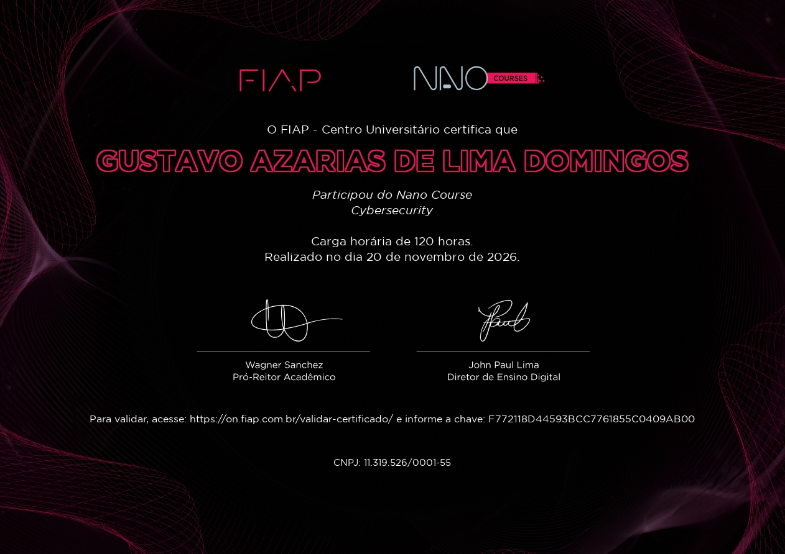
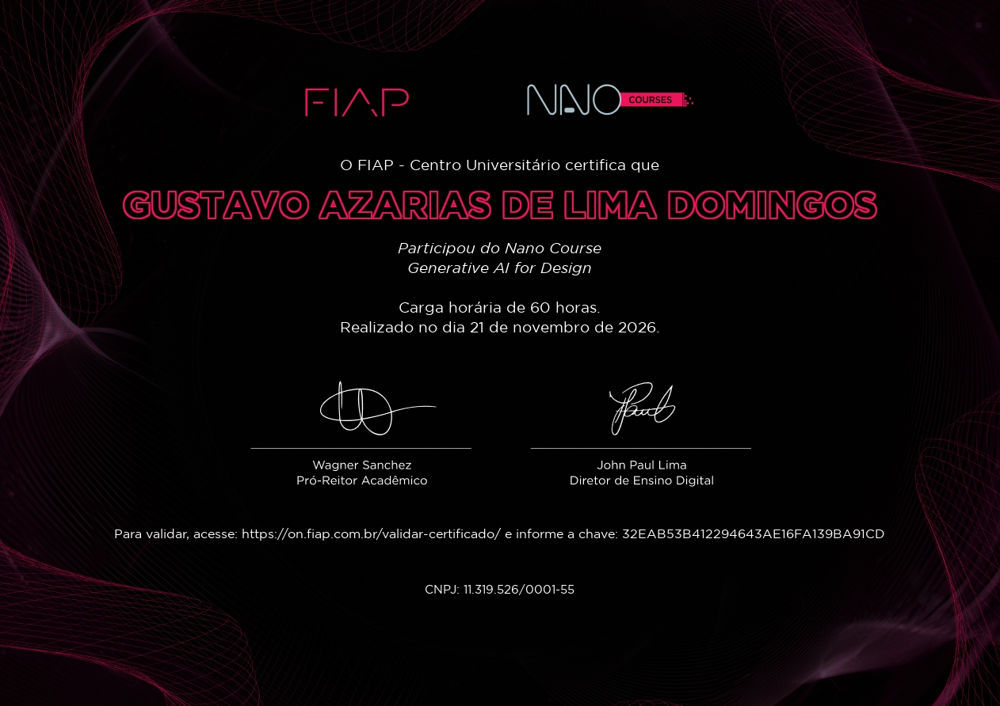

# Certificados e Cursos

Repositório destinado à organização dos meus certificados e cursos realizados na área de Tecnologia da Informação, visando documentar minha evolução acadêmica e profissional.

## Cybersegurança — FIAP

- **Curso:** Nano Course Cybersegurança (Cybersecurity)
- **Instituição:** FIAP
- **Carga horária:** 120 horas
- **Conteúdo estudado:** Fundamentos de Cybersecurity, Segurança da Informação, redes TCP/IP, criptografia, análise de vulnerabilidades, engenharia social, hardening e fundamentos de Pentest.

### Certificado

## IA Generativa para Design — FIAP

- **Curso:** Nano Course IA generativa para design (Generative AI for Design)
- **Instituição:** FIAP
- **Carga horária:** 60 horas
- **Conteúdo estudado:** Inteligência Artificial Generativa, Design Digital, Criatividade, Engenharia de Prompt e Design Gráfico.

### Certificado

